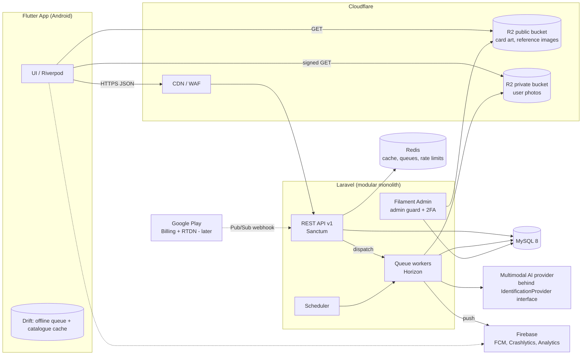

# 02 — System Architecture

## 1. High-level view

## 2. Runtime components

| Component | Responsibility |
|-----------|---------------|
| **REST API** | Stateless HTTP; validation, authorisation, orchestration. Never calls the AI provider synchronously. |
| **Queue workers (Horizon)** | Image processing, AI identification, matching, stats recalculation, notifications, cleanup. Separate queues: `scans` (high), `media`, `default`, `low`. |
| **Scheduler** | Nightly stats reconciliation, orphan media cleanup, AI cost roll-ups, token pruning, budget checks. |
| **Filament admin** | Catalogue curation, rarity management, review queue, AI usage dashboards, user support. Same codebase, separate guard. |
| **MySQL 8** | System of record. InnoDB, utf8mb4. |
| **Redis** | Queues, cache (catalogue, config), rate limiters, scan quota counters, idempotency keys, circuit-breaker state. |
| **R2 (S3 API)** | Binary storage. Accessed only via Laravel's `s3` filesystem driver so the provider is swappable. |
| **AI provider** | Image → structured candidate list. Accessed only through `IdentificationProvider` interface. |
| **Firebase** | Push notifications (scan finished), crash reporting, product analytics. Not used for data or auth. |

## 3. Architectural decisions

### D-01 Modular monolith in Laravel
- **Decision:** One Laravel application, organised into domain modules with explicit boundaries (see doc 05). API, admin, workers and scheduler are the same codebase deployed as different processes.
- **Why needed:** A small team must ship an MVP quickly while keeping the codebase clean enough to grow into a commercial product.
- **Advantages:** One deploy, one database transaction boundary, shared models for Filament, simplest debugging, lowest hosting cost. Matches the team's existing Laravel expertise.
- **Disadvantages:** All modules scale together; a bad deploy affects everything; module boundaries are enforced by convention and tests, not by the network.
- **Scalability:** Horizontally scalable (stateless web nodes behind a load balancer, separate worker nodes). If one module (most likely Identification) needs independent scaling, it can be extracted because it already talks to the rest through interfaces and events.

### D-07 Asynchronous identification
- **Decision:** `POST /scans` stores the image and returns `202 Accepted` with a scan id. A queued job performs AI identification. The client polls `GET /scans/{id}` (1 s → 2 s backoff, max ~30 s) and also receives an FCM data message when done.
- **Why needed:** AI calls take 2–15 s and can fail or time out; holding PHP-FPM workers on them would exhaust the web tier.
- **Advantages:** Web tier stays fast; retries and provider fallback are transparent; cost and rate limiting are centralised in workers; works with the offline queue (upload now, result later).
- **Disadvantages:** More moving parts (status machine, polling). Slight latency overhead (~0.5 s).
- **Scalability:** Scan throughput scales by adding `scans` workers. Provider rate limits are enforced via Redis so adding workers cannot overrun them.

### Laravel is the single source of truth
- Firebase is used for messaging, crash and analytics only. No Supabase, no Firestore. All business rules (rarity, eligibility, confidence) live in Laravel.
- **Advantage:** No split-brain logic between platforms; one audit trail.
- **Disadvantage:** No "free" realtime layer; we use polling + FCM instead, which is sufficient for the MVP.
- **Scalability:** If realtime features (social, trading) arrive, add Laravel Reverb (WebSockets) rather than a second backend.

### API versioning
- Prefix `/api/v1`. Breaking changes ship as `/api/v2` while v1 is maintained until the minimum supported app version moves past it. `GET /app/config` returns `min_supported_version` so old clients can be forced to update.

## 4. Deployment topology

| Stage | Topology |
|-------|----------|
| **Dev** | Laravel Sail / Docker Compose: app, MySQL, Redis, MinIO (S3 emulator), Mailpit |
| **Staging** | 1 VPS (Singapore region, closest to Malaysia) running everything; separate R2 buckets and AI key with low budget |
| **Production MVP** | VPS-A: Nginx + PHP-FPM + Scheduler; VPS-B: Horizon workers; Managed MySQL (or self-managed with automated backups); Redis on VPS-B or managed; Cloudflare in front |
| **Growth** | 2+ web nodes behind load balancer, 2+ worker nodes, managed MySQL with read replica, managed Redis |

Deployment via CI (GitHub Actions): tests → build → zero-downtime deploy (Laravel Envoyer-style symlink swap or Deployer/Forge). Migrations run before code switch and must be backward compatible for one release.

## 5. Observability

| Concern | Tool |
|---------|------|
| Backend errors | Sentry (or Flare) |
| Queue health | Horizon dashboard (admin-only) |
| App metrics | Laravel Pulse (admin-only) |
| Mobile crashes | Firebase Crashlytics |
| Product analytics | Firebase Analytics (event taxonomy in doc 06) |
| AI cost & quality | `identification_requests` table + Filament dashboard + daily roll-up |
| Uptime | External ping on `/api/v1/health` |
| Logs | Structured JSON logs with `request_id`, `user_id`, `scan_id` correlation |

## 6. Cross-cutting conventions

- **IDs:** internal `BIGINT` PKs; public `ULID` exposed in URLs and JSON (`public_id`).
- **Time:** stored UTC; client sends ISO-8601 with offset; user timezone in profile.
- **Money:** integer micro-units (`cost_usd_micros`) — never floats.
- **Idempotency:** `Idempotency-Key` header on `POST /scans` and `POST /encounters`; offline-created records carry a `client_uuid`.
- **Events:** domain events (`EncounterConfirmed`, `SpeciesCollected`, …) decouple modules; listeners update stats and send notifications.
