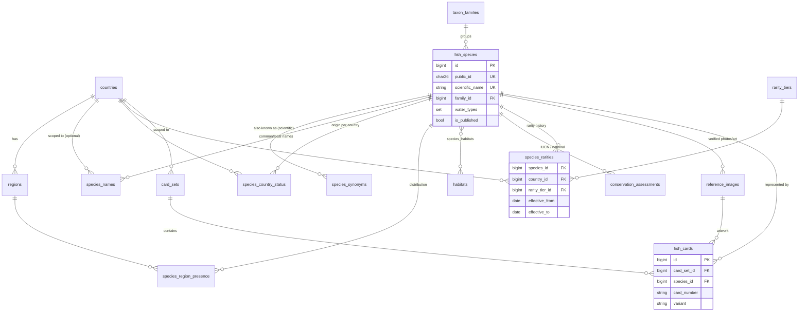
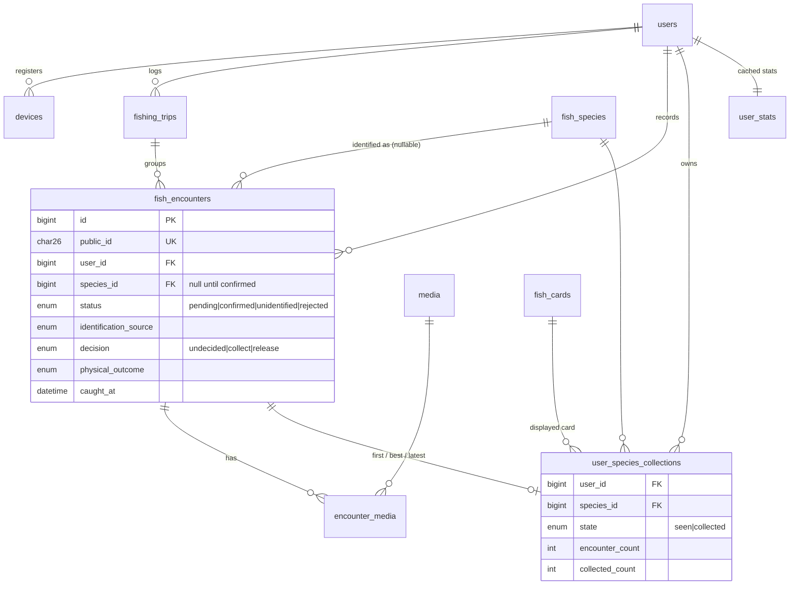
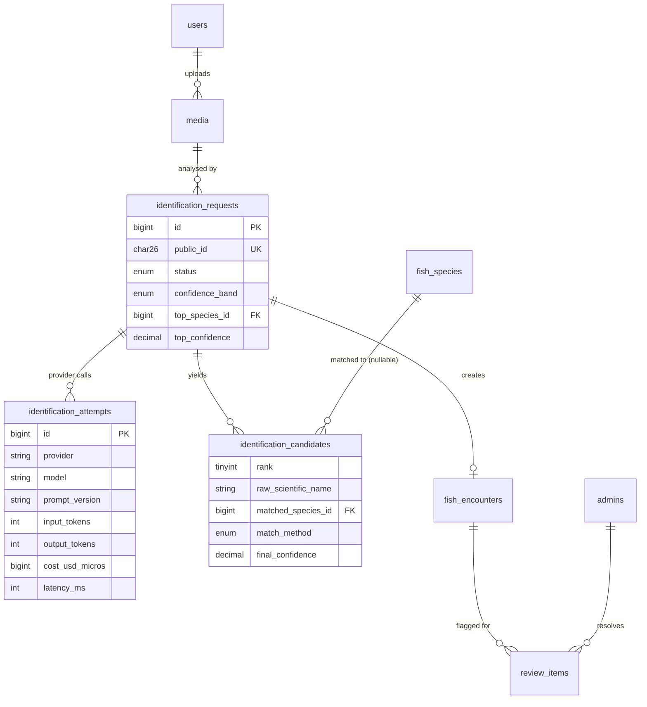

# 03 — Database ERD

Three diagrams keep this readable: **Catalogue**, **Player data**, **AI & media**. Full column definitions are in [04-database-schema.md](04-database-schema.md).

## 3.1 Catalogue (admin-owned, country-aware)

## 3.2 Player data

**Key rule:** `user_species_collections` has `UNIQUE(user_id, species_id)`. Catching the same fish 50 times creates 50 `fish_encounters` and exactly one collection row. Species rows are never duplicated.

## 3.3 AI identification & media

## 3.4 Why these separations (D-04)

| Separation | Why needed | Advantage | Disadvantage | Scalability |
|-----------|-----------|-----------|--------------|-------------|
| Species vs Card | A species is biology; a card is a design artefact that can be re-released in new sets, variants or countries | Card redesigns/new seasons never touch biology data | One extra join for card views (cached) | New sets = new rows; no migration |
| Encounter vs Collection | Encounters are an append-only event log; the collection is a per-user aggregate | No duplicate species records; fast dex grid (one row per species); full history preserved for journal and stats | Aggregate must be kept in sync (event listener + nightly reconciliation) | Collection table grows with users × species collected (bounded, e.g. 100k users × 60 avg = 6M rows — fine for MySQL) |
| Identification request vs Encounter | Many scans are abandoned, failed or "no fish" | Encounter table stays clean; AI cost/quality analytics independent of gameplay | Two tables to inspect when debugging | Identification data can be archived/partitioned by month without touching gameplay |
| Rarity vs Conservation | Rarity is a game mechanic; conservation is a scientific/legal fact | Avoids incentivising hunting of endangered fish; each can change independently | Two concepts to explain in UI | Both are country-scoped |
