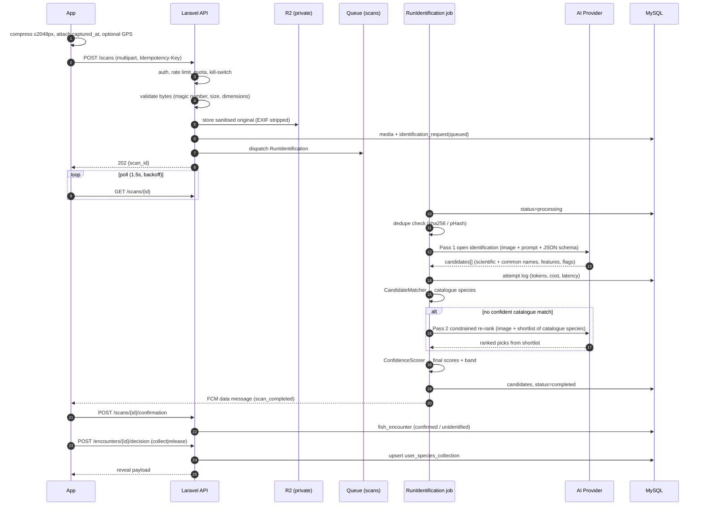

# 08 — AI Identification Workflow

## 1. Principles

1. **The AI proposes; the verified catalogue decides; the user confirms.**
2. The AI never assigns rarity, conservation status or any game value. The prompt does not mention them and the response schema has no field for them.
3. The backend owns confidence. Model self-reported confidence is one input, because LLM self-confidence is poorly calibrated.
4. Every AI call is logged with tokens, cost, latency, model and prompt version.
5. Low confidence never produces a collected card.

## 2. End-to-end sequence



## 3. Step details

| # | Step | Implementation |
|---|---|---|
| 1 | Photograph upload | Client compresses; multipart to API (presigned direct upload is a scale-up option, doc 09) |
| 2 | Image validation | `ImageInspector`: magic bytes (JPEG/PNG/WebP/HEIC), ≤ 8 MB, short side ≥ 400 px, decodable, not animated. Reject early with `image_rejected` |
| 3 | Secure storage | `ImageSanitizer` re-encodes (kills polyglot payloads), auto-orients, strips EXIF after extracting `taken_at`/GPS flag; stored to private bucket; `ai` variant at 1024 px long side |
| 4 | AI identification | Pass 1 with the `ai` variant (smaller = cheaper, enough detail) |
| 5 | Candidate extraction | Strict JSON schema; invalid JSON → one repair retry, then `invalid_output` |
| 6 | Verified DB matching | `CandidateMatcher` (below) |
| 7 | Confidence assessment | `ConfidenceScorer` (below) |
| 8 | User confirmation | API + app UX per band |
| 9 | Collect / Release | `DecideEncounter` + `EligibilityPolicy` |
| 10 | Persistence | Encounter, collection upsert, stats event — in one DB transaction |

## 4. Provider abstraction

```php
interface IdentificationProvider
{
    public function name(): string;                       // 'gemini'
    public function identify(IdentificationInput $in): ProviderResult;   // pass 1
    public function rerank(RerankInput $in): ProviderResult;             // pass 2
    public function supportsStructuredOutput(): bool;
}

final class ProviderResult {
    public function __construct(
        public array $candidates,      // normalised DTOs
        public array $flags,           // no_fish, multiple_fish, screen_photo …
        public int $inputTokens,
        public int $outputTokens,
        public int $latencyMs,
        public string $model,
        public ?array $raw = null,
    ) {}
}
```

`ProviderRouter` picks primary/fallback from `app_settings`, applies a **circuit breaker** (Redis: open after 5 failures/60 s, half-open after 60 s) and per-provider **rate limits** (Redis token bucket sized below the provider's RPM quota).

### D-08 Two-pass identification
- **Why needed:** Open-vocabulary models know thousands of species but may return a name not in our catalogue, an outdated synonym, or a near-miss among look-alikes. Sending the entire catalogue every time is expensive.
- **Pass 1 (open):** image + short prompt: "Identify the fish; return up to 5 candidates with scientific name, common names, key visible features, self-rated confidence; flag no_fish/multiple_fish/screen_or_print/low_quality. Context: photo taken in Malaysia, {region}, {freshwater|marine hint if known}."
- **Pass 2 (constrained, only when needed):** triggered if top match is unmatched, matched only by fuzzy/ambiguous name, or top-2 margin is small. Sends image + a **shortlist** (≤ 25 catalogue species from the matched genus/family + lookalikes + regional presence) including each species' `identification_notes`. The model must choose from the shortlist IDs or "none".
- **Advantages:** Most scans need one cheap call; hard cases get catalogue-grounded reasoning; output is always tied to verified records.
- **Disadvantages:** Hard cases cost ~2× and take longer; two prompts to maintain and evaluate.
- **Scalability:** Shortlists stay small as the catalogue grows across SEA because they are filtered by family + country + region.

### Prompt & schema versioning
Prompts live in code (`Prompts/*`) with a version constant (`id-open-v1`). Every attempt stores `prompt_version`, so accuracy can be compared per version in the evaluation dashboard. Changing a prompt = new version + evaluation run before activation.

## 5. Candidate matching (`CandidateMatcher`)

For each AI candidate, in order:
1. `scientific_exact` — normalised scientific name equals `fish_species.scientific_name` (published). score 1.00
2. `synonym` — matches `species_synonyms.normalized_name`. score 0.95
3. `common_name` — matches a non-ambiguous `species_names.normalized_name` for the country. score 0.80
4. `fuzzy` — Levenshtein / trigram on scientific name within same genus (typos). score 0.60–0.75
5. `none` — not in catalogue → candidate kept for analytics (`not_in_catalogue` gap report for curators), not shown as collectible.

Ambiguous common names (e.g. "baung", "kerapu" that cover many species) never resolve a candidate by themselves.

## 6. Confidence scoring (`ConfidenceScorer`) — D-09

```
final = clamp(
    0.45 * model_confidence          // AI self-rating, 0–1
  + 0.25 * match_score               // from matcher
  + 0.20 * margin                    // (top1_model - top2_model), scaled to 0–1
  + 0.10 * agreement                 // pass-2 picked same species = 1, else 0, no pass-2 = 0.5
  - geo_penalty                      // 0.15 if species not recorded in country; 0.05 if not in region
  - quality_penalty                  // 0.10 if low_quality flag
, 0, 1)
```

| Band | Rule (defaults, admin-tunable) | UX |
|---|---|---|
| **High** | final ≥ 0.80 AND margin ≥ 0.15 AND match ∈ {exact, synonym, constrained_pick} | Top species pre-selected; 1-tap confirm |
| **Medium** | 0.55 ≤ final < 0.80 | Show top 3; user must choose or "none of these" |
| **Low** | final < 0.55 or no catalogue match | No pre-selection; options: search catalogue manually, or save as unidentified |
| — | `no_fish` / `unsupported_image` / `multiple_fish` | Retry guidance (crop to one fish, better light, show full body) |

Weights and thresholds are starting points. They are **calibrated** against the evaluation set before launch (target: ≥ 95% precision in the High band).

## 7. Eligibility & integrity checks

- `sha256` match with another user's media → `duplicate_image` flag → not collect-eligible, review item.
- pHash near-match (Hamming ≤ 6) with another user's media → review sample.
- AI flag `screen_or_print` → not collect-eligible.
- EXIF `taken_at` far from `captured_at` (> 30 days) or from the future → flag only (gallery uploads of older catches are legitimate).
- Same user re-scanning the same image → cached result returned (no new AI cost).

## 8. Reliability

| Concern | Setting |
|---|---|
| HTTP timeout per provider call | 20 s connect+read |
| Job timeout | 60 s; `tries = 3`, backoff 5 s / 15 s |
| Fallback | After primary fails twice or breaker open → secondary provider |
| Total failure | status `failed`; user sees "We couldn't identify this right now — we'll retry" and the scan is retried by scheduler once within 10 min; no quota charged for failed scans |
| Stuck jobs | Scheduler marks `processing` > 2 min as `timed_out` and re-queues once |

## 9. Rate limiting & cost control — D-15

| Control | Mechanism |
|---|---|
| Per-user burst | 6 scans/min (Laravel RateLimiter, Redis) |
| Per-user quota | Daily/monthly scans by plan via `EntitlementService` (free plan configurable) |
| Provider RPM | Redis token bucket per provider |
| Global daily budget | `AiBudgetGuard` sums today's `cost_usd_micros`; at 80% → alert; at 100% → kill-switch (`503 ai_temporarily_unavailable`, app queues scans) |
| Dedupe cache | sha256 → cached result for 30 days |
| Image size | AI variant capped at 1024 px |
| Model tiering | Cheapest model that meets accuracy target for pass 1; stronger model only for pass 2 if evaluation proves benefit |

## 10. Logging & privacy

- Stored per attempt: provider, model, prompt_version, tokens, cost, latency, status, parsed JSON (90 days).
- Not stored: API keys, full raw HTTP bodies with image bytes.
- Use provider tiers/settings where submitted images are **not used for model training**; record this in the privacy policy.
- No user personal data (name, email, precise GPS) is sent to the AI — only image, country, state, water-type hint.

## 11. Beta mode: free-tier AI (D-16)

**Decision:** Closed beta runs on the **Gemini API free tier** (unpaid quota). Production and open beta run on a paid tier. Switching is configuration only (`AI_TIER=free|paid` + provider key), no code change, because of the provider abstraction.

**Constraints of the free tier that shape the design (verify in AI Studio at setup — they change without notice):**

| Constraint | Design response |
|---|---|
| Low per-project limits on requests per minute, tokens per minute and **requests per day**. Limits are per Google Cloud project, not per key, and are tighter for preview models | `FreeTierBudget` reads RPM/RPD from `app_settings` (entered from the AI Studio rate-limit page); Redis token bucket enforces them. Use a stable (non-preview) Flash or Flash-Lite model. Never rotate multiple keys/projects to dodge limits (Terms violation, account risk). |
| RPD resets at **midnight Pacific time** (≈ 15:00–16:00 Malaysia time depending on US daylight saving) | `AiCapacity` counts the project's daily AI requests on the Pacific reset. Each user's own scan quota stays on their local (Malaysian) day so it's easy to explain in the app. |
| Daily cap will be hit | New status `waiting_capacity`: scan is stored and queued; app shows "Queued — results after 4 pm" (calculated); scheduler releases waiting scans after reset, FIFO. No error, no lost scans. |
| Pass 2 doubles requests | `pass2_enabled=false` in free mode by default; medium/low results rely on top-3 UX. Re-enable per-request only if headroom > 50% of RPD. |
| Retries burn quota | Free mode: max 1 retry; 429 responses are not retried immediately — the scan goes to `waiting_capacity`. |
| Data handling: on unpaid services Google may use submitted content to improve its products, and human reviewers may see inputs/outputs; Google says not to submit sensitive or personal information | Beta consent screen + privacy notice disclose this; only the 1024 px AI variant is sent (EXIF already stripped, no GPS, no user data); in-app tip "photograph the fish, avoid faces/documents". |
| Paid-only requirement in EEA/Switzerland/UK | Beta restricted to Malaysia (Play closed track country targeting). |

**Per-user beta quota:** `free_tier_daily_rpd × 0.8 ÷ active testers` (e.g. if the project allows 250 RPD and there are 40 testers → 5 scans/day each). 20% is reserved for dev/admin testing. Developers use `FakeProvider` locally so they don't consume the beta quota.

**Switch-to-paid triggers** (any one): capacity cap hit on ≥ 3 days in a week; testers > what RPD supports at 3 scans/day; starting open beta or production; any user-facing release outside Malaysia.

**Evaluation set on free tier:** run the provider evaluation in daily batches using the dev project's own quota (e.g. 300-image core set first, rest over following days). The full multi-provider bake-off is still recommended before production; it is a one-off cost of tens of dollars.

## 12. Quality loop

1. **Evaluation set** (before M3 exit): ≥ 20 verified photos × 100 most common MY species, plus look-alike pairs and negative images. `php artisan fishdex:ai-eval --provider=… --prompt=…` reports top-1/top-3 accuracy, band precision, cost, latency.
2. **Provider bake-off**: run the same set across 2–3 multimodal providers; pick on accuracy-per-dollar.
3. **Review queue**: random 2% sample of confirmed encounters + all disputes + all low-confidence user picks. Corrections feed back into the eval set and `identification_notes`.
4. **Gap report**: `not_in_catalogue` names ranked by frequency → curators add species.
